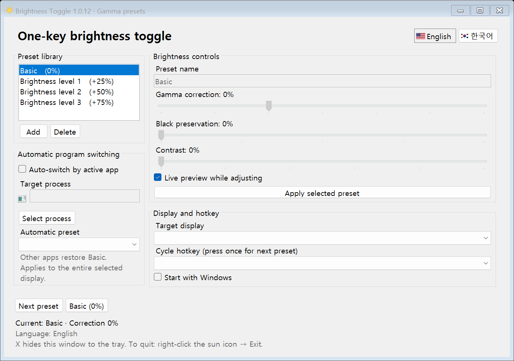
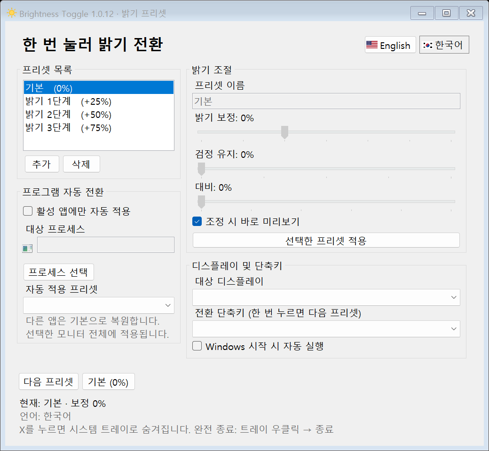

# Brightness Toggle

**어두운 SDR 화면을 위한 원버튼 감마 프리셋 전환 도구.**

[← 포트폴리오](README.md) · [GitHub](https://github.com/idlepoe/brightness_toggle) · [Windows ZIP 다운로드](https://github.com/idlepoe/brightness_toggle/releases/latest) · [Microsoft Store](https://apps.microsoft.com/detail/9NWT13R8QZG6)

Windows 10/11 x64에서 실행되는 C#·WinForms 프로그램입니다. F9로 기본(0%)·+25%·+50%·+75% 프리셋을 순환하거나, 원하는 이름과 보정값으로 프리셋을 추가합니다. 게임이나 프로그램을 활성화했을 때만 선택한 프리셋을 자동 적용할 수도 있습니다.

## 주요 기능

| 영역 | 구현한 기능 |
|---|---|
| 프리셋 | 기본 단계와 사용자 프리셋 추가·편집·삭제, F9 순환 |
| 화면 보정 | 감마·검정 유지·대비 조정, 실시간 미리보기, 대상 디스플레이 선택 |
| 자동 전환 | 프로세스 이름·창 제목으로 대상 검색, 활성 앱에 적용, 다른 앱으로 이동하면 기본 복원 |
| 사용 편의 | 우측 하단 상태 알림, 트레이 왼쪽 클릭으로 설정 열기, 선택 사항인 Windows 자동 시작 |
| 언어 | 영어 기본, 한국어 즉시 전환과 설정 저장 |

## 영어 화면

프리셋 목록, 밝기 보정, 활성 앱 자동 전환, 디스플레이·단축키 설정을 그룹으로 구분했습니다.

## 한국어 화면

같은 기능을 한국어로 사용할 수 있으며, 닫기 버튼은 트레이로 숨기는 동작임을 화면 하단에 안내합니다.

## 동작 범위

모니터의 물리적 백라이트가 아닌 **SDR 감마 곡선**을 조절합니다. 특정 프로그램을 대상으로 자동 전환하더라도 선택한 모니터 전체에 적용됩니다. HDR·독점 전체화면·다른 보정 도구에 따라 효과가 달라질 수 있습니다. 정상 종료하면 원래 감마를 복원합니다.

**기술:** C# · .NET 10 · WinForms · Windows Gamma Ramp API · MSIX / Windows Startup Task.

화면 기준 버전은 1.0.12입니다. 이미지는 실제 앱의 테스트용 화면을 렌더링한 것으로, 실제 모니터 감마를 변경하지 않고 캡처했습니다. [스크린샷 출처·버전 정보](assets/windows-project-screenshots.json)
