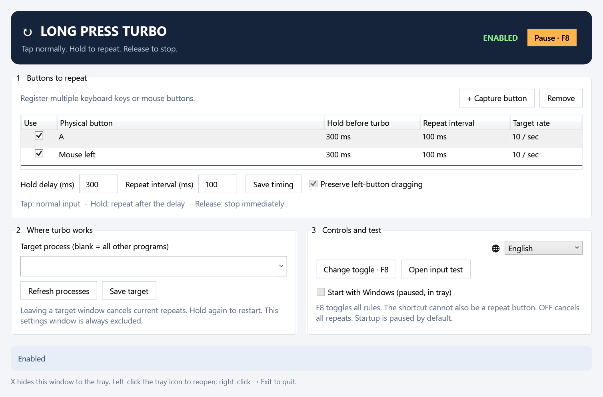
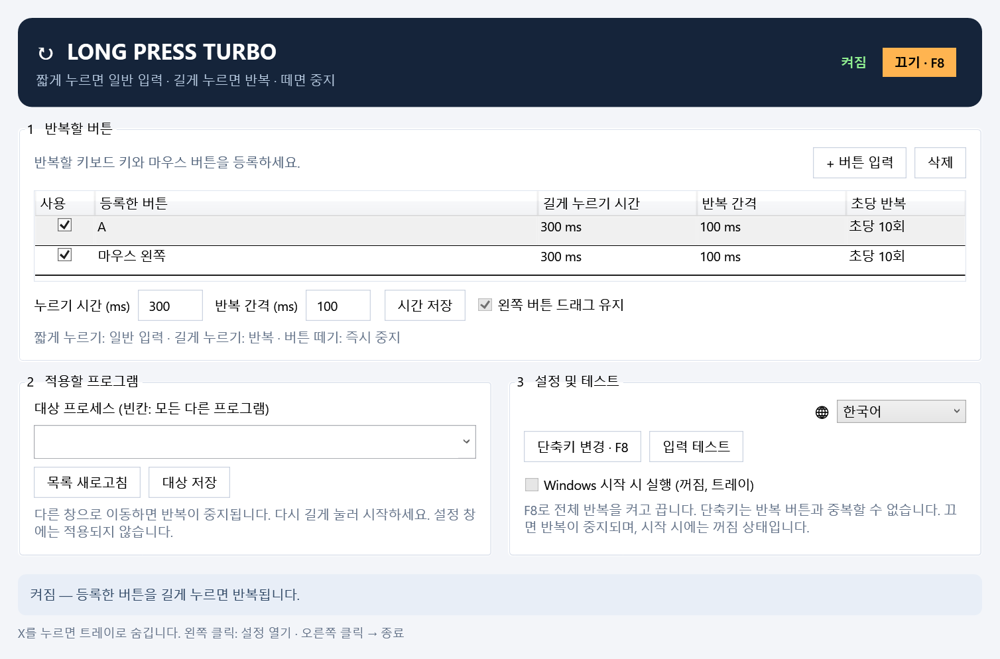

# Long Press Turbo

**짧게 누르면 일반 입력, 길게 누르면 터보 반복, 떼면 즉시 중지.**

[← 포트폴리오](README.md) · [GitHub · 비공개 소스](https://github.com/idlepoe/long_press_turbo) · [Microsoft Store · 인증 제출](https://apps.microsoft.com/detail/9NNVFZ6033HH)

키보드 키와 마우스 버튼을 길게 눌렀을 때 반복 입력으로 바꾸는 C#·WPF Windows 유틸리티입니다. 여러 버튼을 실제 물리 입력으로 등록하고 각각 다른 누르기 시간과 반복 간격을 설정할 수 있습니다.

## 주요 기능

| 영역 | 구현한 기능 |
|---|---|
| 버튼 등록 | 직접 누른 키보드 키와 마우스 왼쪽·오른쪽·가운데·측면 1·2 버튼 등록 |
| 반복 규칙 | 여러 버튼의 독립 반복, 버튼별 지연·간격·사용 여부 설정, 해제 시 중지 |
| 전체 제어 | F8 기본 켜기·끄기, 물리 입력으로 단축키 변경, 시작 시 항상 꺼짐 |
| 적용 대상 | 모든 다른 프로그램 또는 지정한 활성 프로세스, 창을 바꾸면 진행 중인 반복 취소 |
| 테스트·마우스 | 입력 테스트 창, 왼쪽 버튼 드래그 유지 선택 옵션 |
| 알림·트레이 | 작업 포커스를 가져가지 않는 ON/OFF 알림, X로 트레이 이동, 왼쪽 클릭으로 설정 열기 |
| 설정 | 영어 기본·한국어 전환, 설정 저장, 선택 사항인 Windows 자동 시작 |

## 영어 화면

반복할 버튼, 적용할 프로그램, 설정·테스트를 세 그룹으로 나눴습니다. 예시에서는 A와 마우스 왼쪽 버튼을 각각 300ms 동안 누르면 100ms 간격으로 반복하도록 등록했습니다.

## 한국어 화면

언어를 바꾸면 설정 화면·트레이 메뉴·입력 등록 창·상태 알림에 즉시 적용되며 다음 실행에도 유지됩니다.

## 배포와 호환성

- Windows 10(2004 이상) / Windows 11 x64용입니다.
- **1.0.0을 2026년 11월 4일 Microsoft Store 인증에 제출했습니다.** 승인 후 자동 게시하도록 설정했으며, 심사·게시 완료 전에는 Store 페이지가 표시되지 않을 수 있습니다. Store ID: `9NNVFZ6033HH`.
- Windows 입력 감지와 `SendInput`을 사용합니다. 드라이버·게임 내부 코드 삽입은 사용하지 않습니다.
- 일부 게임·안티치트·관리자 권한 프로그램은 자동 입력을 차단할 수 있습니다. 조합 키·매크로는 지원하지 않습니다.
- 입력 이력을 기록하거나 외부로 전송하지 않습니다. [개인정보처리방침](https://gist.github.com/idlepoe/7ef8e5ee6fa7d23123f0535b44b15e0e)

**기술:** C# · .NET 10 · WPF · Windows Low-Level Input Hooks · SendInput · MSIX / Windows Startup Task.

화면 기준 버전은 1.0.0입니다. 이미지는 실제 WPF 화면을 테스트용 입력 처리기로 144 DPI에서 렌더링한 것으로, 실제 사용자 입력 이력은 포함하지 않습니다. 소스 저장소는 비공개이며 이 포트폴리오의 스크린샷은 공개로 열람할 수 있습니다. [스크린샷 출처·버전 정보](assets/windows-project-screenshots.json)
