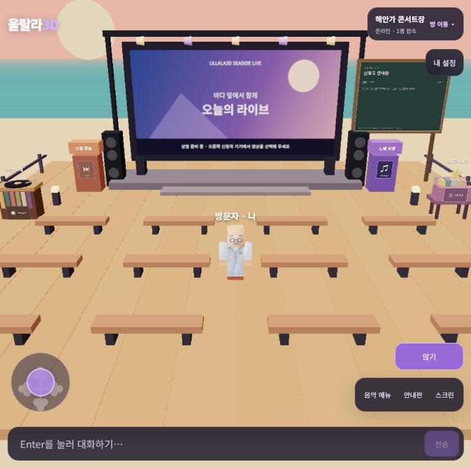
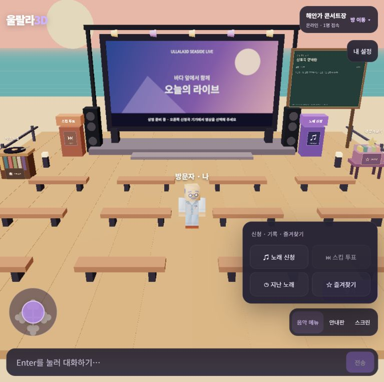
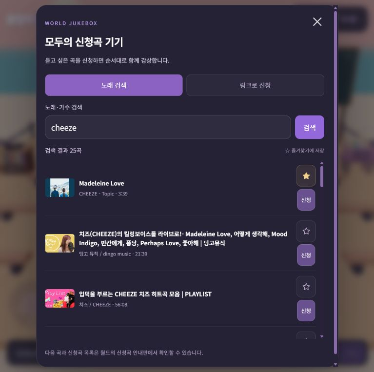
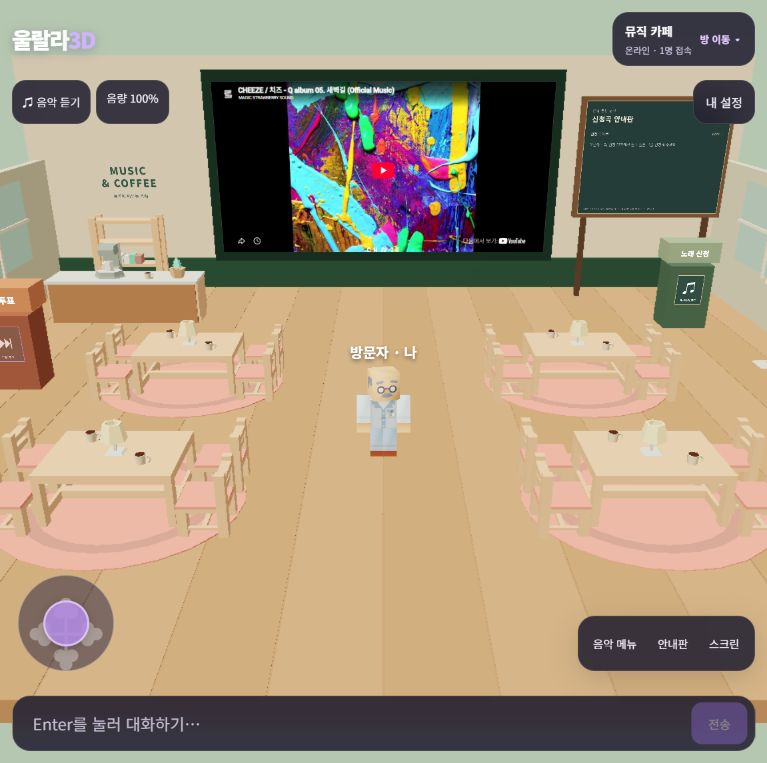
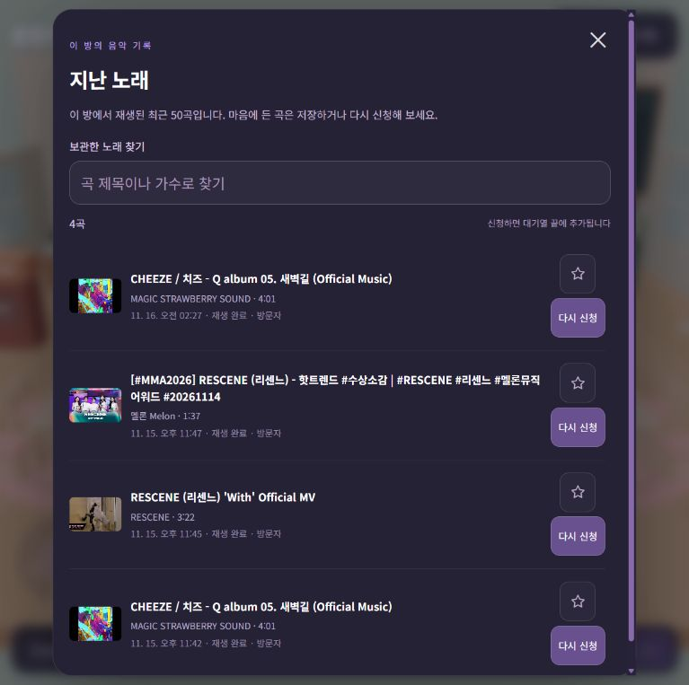
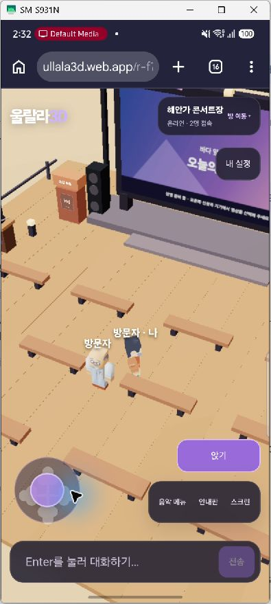
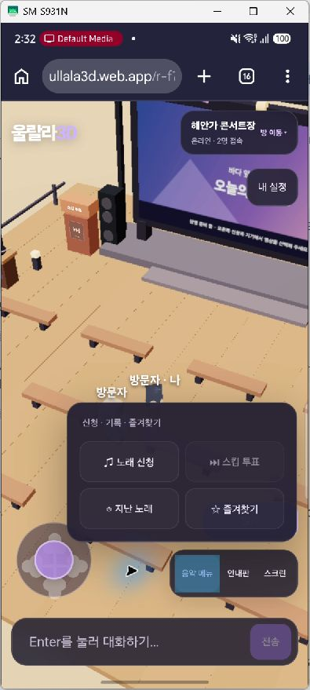
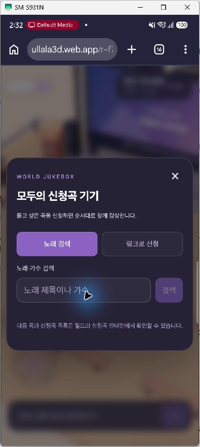

# 울랄라3D · ULLALA3D

**아바타로 만나 대화하고, 같은 공간에서 YouTube 음악을 함께 감상하는 3D 웹 월드.**

[← 포트폴리오](README.md) · [웹에서 이용](https://ullala3d.web.app/) · [GitHub](https://github.com/idlepoe/ullala3d) · [해안가 콘서트장 바로 입장](https://ullala3d.web.app/r-f717e56349f7)

기존 울랄라3의 공동 음악 감상 경험을 3D 공간으로 확장한 프로젝트입니다. 메뉴를 상시 나열하는 대신 신청 기기·안내판·투표 기기·레코드 선반·즐겨찾기 보관함에 역할을 나누고, 음악을 들으며 자유롭게 이동하고 대화할 수 있도록 구성했습니다.

## 주요 기능

| 영역 | 구현한 기능 |
|---|---|
| 공간과 방 | 야외 극장 24석·뮤직 카페 16석·해안가 콘서트장 24석, 방 생성·찾기·초대 링크, 방별 채팅과 신청곡 분리 |
| 아바타와 대화 | 캐릭터 9종, 외형 선택 저장과 실시간 공유, 걷기·앉기, 말풍선 채팅, Enter 입력·전송과 Esc 입력 종료 |
| 음악 신청 | YouTube 제목·가수 검색, 최대 25개씩 결과 조회와 더 보기, 링크 신청, 최대 20곡 대기열과 신청 순서 자동 재생 |
| 공동 감상 | 월드 고정 스크린, 개인별 재생·일시정지·음량, 방송 위치 재합류, 안내판에서 대기 순서 확인과 본인 신청 취소 |
| 스킵 투표 | 접속자 과반수 찬성 시 알림 후 5초 뒤 다음 곡으로 이동 |
| 기록과 즐겨찾기 | 방별 최근 재생 기록 50곡, 지난 곡 즉시 재신청, 브라우저 로컬 즐겨찾기 저장·해제·재신청 |
| PC·모바일 조작 | PC 키보드 이동, 모바일 조이스틱과 터치 시점 회전, 의자 앉기·일어나기, 접이식 음악 메뉴·설정·음량 |

## 실제 사용 화면

2026년 11월 16일 운영 서비스에서 직접 캡처한 화면입니다. 아래 브라우저 캡처는 좁은 창의 반응형 화면이며, 실제 휴대폰 캡처는 별도 Android 항목으로 구분했습니다. 검색 결과·영상 이미지·재생 기록은 촬영 당시의 상태입니다.

### 음악 메뉴

상시 노출되는 버튼을 줄이고, 노래 신청·스킵 투표·지난 노래·즐겨찾기는 ‘음악 메뉴’를 열었을 때만 표시합니다. 안내판과 스크린에는 하단 도구 모음에서 접근할 수 있습니다.

### 노래 검색과 신청

노래·가수로 검색하고 결과에서 곡을 신청하거나 별 버튼으로 저장합니다. 다음 곡과 신청곡 목록은 신청 창에 중복 표시하지 않고 월드 안내판에서 확인합니다.

### 뮤직 카페

커피 카운터·테이블·16석 의자와 벽면 스크린을 배치했습니다. 장소가 바뀌어도 이동·채팅·음악 신청 방식을 동일하게 유지합니다.

### 지난 노래

재생이 끝나거나 스킵한 곡을 방별로 기록합니다. 지난 곡을 다시 신청하면 현재 곡을 중단하지 않고 대기열 끝에 추가합니다. 즐겨찾기는 방 기록과 별개로 해당 브라우저에 저장합니다.

## 실제 Android 사용 화면 · scrcpy

**Samsung Galaxy S25(SM-S931N), Android 17, Chrome에서 실행하고 scrcpy 3.3.4로 미러링한 화면입니다.** 브라우저 창 크기만 줄인 시뮬레이션이 아닌 실제 연결된 휴대폰 화면이며, 확인할 수 있도록 scrcpy 창 테두리를 포함했습니다.

| 해안가 월드 | 음악 메뉴 | 노래 신청 |
|---|---|---|
|  |  |  |

왼쪽 조이스틱과 터치 조작, 음악 메뉴 열기, 신청 창 열기·닫기를 확인했습니다. 기기 성능과 브라우저의 자동 재생 정책에 따라 첫 음악 재생에는 사용자 터치가 필요할 수 있습니다.

## 구현 구성

| 계층 | 사용 기술과 역할 |
|---|---|
| 웹 UI | React · TypeScript · Vite, 접이식 도구 모음과 반응형 메뉴 |
| 3D 월드 | Three.js · React Three Fiber · Drei, GLB 아바타와 가구, 장소별 무대 구성 |
| 이동과 충돌 | Rapier · ecctrl, 키보드·터치 이동, 좌석 상호작용 |
| 실시간 공유 | Firebase Authentication 익명 인증, Realtime Database 접속 상태·아바타 위치, Firestore 채팅·방·음악 상태 |
| 서버 처리 | Cloud Functions에서 신청·취소·순서 전환·스킵 투표·재생 기록 처리, 서버에서 YouTube API 호출 |
| 배포 | Firebase Hosting |

음악 상태 변경은 서버에서 처리하고, 트랜잭션과 요청 식별자로 동시 신청·중복 호출에 대응합니다. 음량과 일시정지는 개인 설정으로 처리하여 다른 사람의 감상을 멈추지 않습니다. 아바타와 카페 가구는 Kenney의 CC0 에셋을 사용하며, 해안가 배경과 무대는 프로젝트 내 3D 도형으로 구성했습니다.

## 사용 범위

- 브라우저에서 이용하는 웹 서비스이며 별도 설치형 Android/iOS 앱은 아닙니다.
- 즐겨찾기는 현재 기기·브라우저에 저장됩니다. 다른 기기와 동기화되지 않으며 브라우저 데이터 삭제 시 사라집니다.
- YouTube 검색 결과는 재생 가능 여부에 따라 한 페이지에 25개보다 적게 표시될 수 있습니다.
